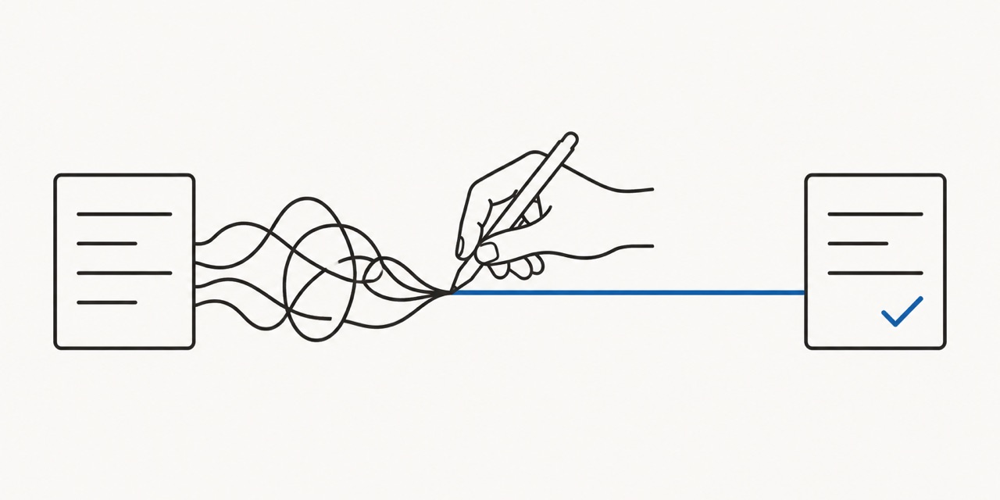
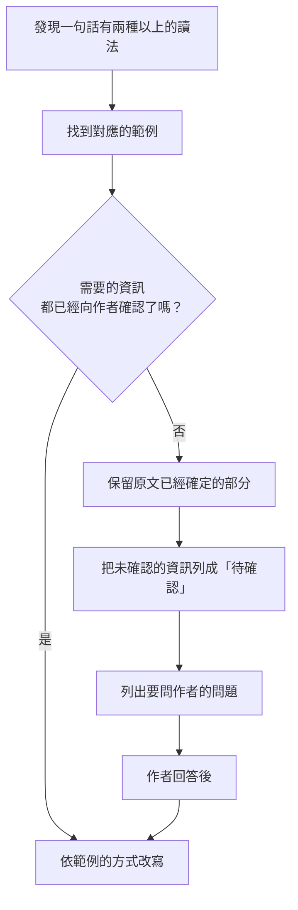

# 受控技術中文

  

**Controlled Technical Chinese**：用在繁體中文（台灣）軟體規格與需求文件的受控寫作規範。

> 狀態：草稿。規則和範例都可能改變。

## 這是什麼

軟體規格裡的一句話，常常有好幾種讀法：

> 送出後會建立新的訂單，並寄出通知。

是誰送出？通知寄給誰？訂單建立失敗時，還寄不寄？讀者各自猜一個答案，實作出來的東西就不一樣。

  

向作者確認這三個問題的答案後，同一句話改寫成：

> 買家送出訂單後，系統建立一筆新訂單。訂單建立成功後，系統寄一封電子郵件通知賣家。訂單建立失敗時，系統不寄通知。

這個改寫的前提和說明，見範例 [C1](examples/c-omitted-actor.md#c1主詞被省略)。

受控技術中文是一套寫作規則，目標是讓規格裡的每一句只有一種讀法。讀者包括：

- 實作的工程師。
- 測試和審查的人。
- 讀規格來寫程式的 LLM agent。

## 和 ASD-STE100 的關係

  

這份規範受 [ASD-STE100](https://www.asd-ste100.org/)（Simplified Technical English）的設計原則啟發，例如一個詞只有一個意思、一句只寫一件事。

這份規範不是 STE100 的翻譯，也不是 ASD 的官方文件。STE100 的詞表和規則是為英文設計的；這份規範依中文的特性和軟體規格的需要，從實際的範例重新整理。

## 內容

| 文件 | 內容 |
|---|---|
| [rules.md](rules.md) | 規則。分成 7 章：名稱；動詞和情態詞；句子；範圍、條件和數量；時間和數值；狀態、資料和錯誤；不確定的內容 |
| [word-list.md](word-list.md) | 詞表。規格句裡需要檢查的詞和符號，以及對應的規則 |
| [examples/](examples/README.md) | 改寫前和改寫後的範例，分成 24 類。每條規則都連到支持它的範例 |
| [references.md](references.md) | 參考資料，以及這份規範和相近的中文專案有什麼差別 |

每個範例都有下列四段：

- 改寫前：原本的句子。
- 問題：這句話有哪幾種讀法，或少了什麼資訊。
- 改寫後：建議的句子。
- 重點：這個範例要說明的原則。

部分範例另有「本例的前提」或「本例不涵蓋」段落。各段落的使用條件見 [examples/README.md](examples/README.md)。

範例改編自真實的軟體規格。產品名稱、功能和數字都已換成通用情境，例如電商、客服工單、檔案管理。

## 怎麼使用

### 寫規格時

把 [rules.md](rules.md) 的檢查項目當成檢查清單。

### 審查規格時

發現一句話有兩種以上的讀法時，依下列流程處理：

### 給 LLM agent 讀規格時

  

人讀到缺漏的資訊時，通常會提出問題。LLM agent 常常自己補上一個猜測，然後繼續寫程式。所以：

- 把 [rules.md](rules.md) 的規則放進 agent 的指示裡。
- 指示 agent 把還沒確認的資訊列成「待確認」。
- 指示 agent 列出要問作者的問題。
- 指示 agent 不把猜測寫成已確定的內容。

[SKILL.md](SKILL.md) 是給 agent 用的技能檔，已經寫好上面這些指示，以及審查和改寫的步驟。這個 repo 的根目錄就是一個技能資料夾。以 Claude Code 為例，把 repo clone 到 `~/.claude/skills/controlled-technical-chinese`，agent 就可以使用。

## 授權

本專案的 README、規則和範例的文字，以 [CC BY 4.0](LICENSE) 授權。你可以分享和改作，包括商業用途。分享原文或改作的版本時：

- 依 LICENSE 保留授權方提供的署名和相關聲明。
- 附上授權條款或它的連結。
- 修改了內容時，標示你做了修改。
